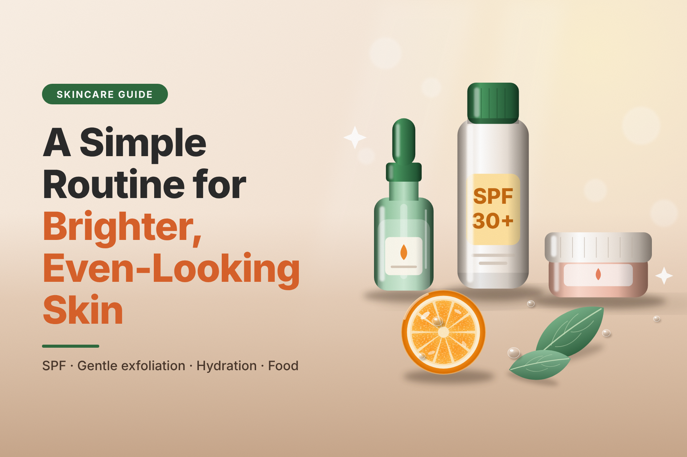

# Skin Brightening Myths vs. Facts
 

 
An 8-card myth-or-fact quiz that separates the facts from the hype about skin brightening pills. Every answer comes with a short explanation, and the final screen lets you review each card.
 
**Live page:** https://nubestimmunegummies.github.io/skin-brightening-myths-vs-facts/
 
Built with plain HTML, CSS, and vanilla JavaScript. No frameworks, no build step, no tracking.
 
## Features
 
- **One card at a time:** read a statement, then choose *Myth* or *Fact*.
- **Instant explanation:** a verdict stamp and a plain-English explanation appear after every answer.
- **Score and review:** a progress bar tracks your answers, and the result screen lists every statement with the correct answer.
- **Shuffled deck:** the cards are reordered each time you play.
- **Keyboard friendly:** press `M` for Myth or `F` for Fact.
- **Local-only best score:** saved in your browser with `localStorage` and never leaves your device.
- **Works without JavaScript:** the statements and answers are plain HTML, so they show as a readable list if scripts are disabled.
- **Accessible markup:** visible focus states, an `aria-live` region for feedback, and reduced-motion support.
- **Responsive:** designed for phones first, then scaled up to desktop.
## Project structure
 
```
.
├── index.html     # Page markup and the statement deck (plain HTML)
├── style.css      # Styles
├── script.js      # Quiz logic: shuffle, scoring, review, best score
├── README.md
└── assets/
    └── skin-brightening-routine-thumbnail-realistic.png
```
 
## Run it locally
 
Clone the repository and open `index.html` in any modern browser. No server is required.
 
```bash
git clone https://github.com/nubestimmunegummies/skin-brightening-myths-vs-facts.git
cd skin-brightening-myths-vs-facts
open index.html   # macOS. On Windows use: start index.html
```
 
## Deploy with GitHub Pages
 
1. Go to **Settings → Pages** in this repository.
2. Under **Build and deployment**, set **Source** to **Deploy from a branch**.
3. Choose the `main` branch and the `/ (root)` folder, then save.
4. After a minute or two the page is live at `https://nubestimmunegummies.github.io/skin-brightening-myths-vs-facts/`.
If you rename the repository, update the canonical URL, `og:url`, and `og:image` tags near the top of `index.html` to match.
 
## Edit the quiz
 
The statements live in the `<ol id="deck">` list in `index.html`. Each `<li>` holds one card:
 
```html
<li data-answer="myth">
  <p class="deck__q">The statement shown on the card.</p>
  <p class="deck__why">The explanation shown after the player answers.</p>
</li>
```
 
Set `data-answer` to `myth` or `fact`. The score messages and the end screen adjust automatically to the number of cards, so you can add or remove items without touching `script.js`.
 
## Content notes
 
- The statements follow the points covered in NuBest's article [Pills that lighten skin: myths, facts, and tips](https://www.nubest.com/blogs/beauty-care/pills-that-lighten-skin).
- To see what one brand's range looks like, the [skin brightening supplements collection on NuBest](https://www.nubest.com/collections/skin-brightening-supplement) is a shop page for that range.
- This project is published by NuBest Nutrition, and both links above lead to NuBest's website.
## Disclaimer
 
This page is for general information only and is not medical advice. Individual results may vary. Factors such as age, genetics, and lifestyle play a role in achieving desired outcomes. These statements have not been evaluated by the Food and Drug Administration. Dietary supplements are not intended to diagnose, treat, cure, or prevent any disease. Consult a physician before using any supplement, especially if you are pregnant, nursing, taking medications, have a medical condition, or are under 18.
